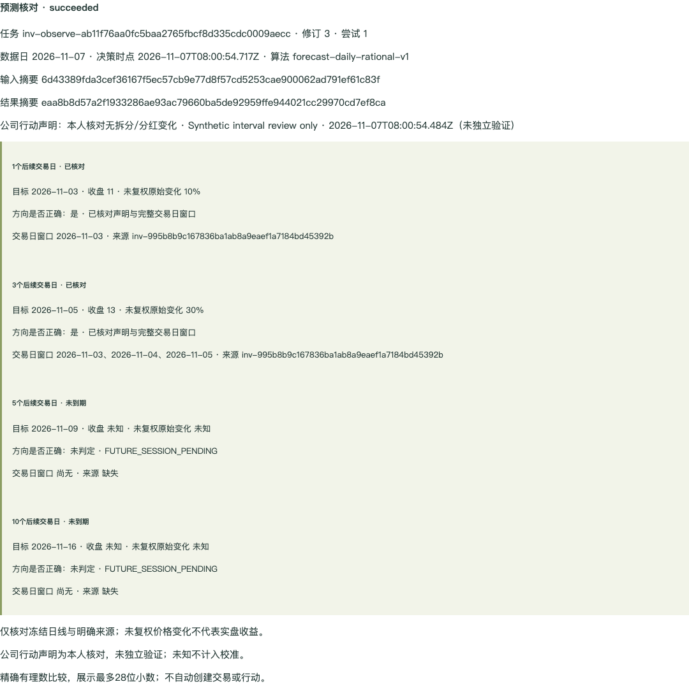

# 预测、复盘与日线监控验收（2026-11-07）

本轮有界切片 **4/4 通过**；原主任务仍 **21/27**，U0/U5 整项保持未完成。机器证据见 [prediction-monitor.json](prediction-monitor.json)，关闭范围见[子任务](../../plans/grow-zook-native-web/prediction-monitor-subtasks.md)。全部使用 localhost 专库、合成账号和 CSV；未读取真实历史/凭据、请求真实模型/行情、迁移真实数据或发布。Grow 仍是 React 静态前端，服务和 worker 均在 Zook。

## 已交付行为

- 预测使用独立 ID，登记后不改写方向、概率、理由、反证及原始基准。固定当时可获知且已完成的最近交易日、标的和完整快照；研究/资料/规则/筛选结果通过服务端核对 id/version/digest 后显式采用。无资产账户也可使用，归档/恢复不覆盖历史。
- 核对冻结输入、交易日历、可获知/决策时点、算法与结果摘要。1/3/5/10 个登记后开市的交易日分别显示已核对、未到期、未知；盘中登记不把该日计为后续交易日。缺失/冲突/超出日历覆盖不补零；月底日历保留最多28天的当前参考覆盖，不保证未覆盖年份。
- 精确有理数计算与十进制字符串；未复权价格变化不表示含分红真实收益。只有完整区间与本人明确“无拆分/现金分红变化”声明才判方向；声明仍标注未独立验证。无声明或数据不足不计命中。概率校准仅聚合已确认且已解决结果，提供有理数 Brier/命中口径，不把未知当错误或正确。
- 复盘绑定具体成功核对与周期，正文/学习/下一步保留版本和原文。CAS 冲突显示基线、本机、云端；下一步只是复盘内容，不自动创建行动。
- 日线监控支持收盘、单日变化、前5日成交量比、收盘高于 MA20、MA5>MA10>MA20。供应商明确选择，仅检查已有快照；自动当天来源必须唯一，缺失/歧义明确未知，不请求或静默切换供应商。交易日、收盘时点、零分母、MA 数据不足均有解释。包含手动/定时检查、冷却、按配置版本/来源日去重、持久站内事件已读、停止与归档恢复；恢复仍保留停止状态。
- 复用现有 worker 与 owner 事务入口，计算在事务外。每 owner 活动2、UTC日40、保留300任务，30秒计算期限、60秒租约、最多三次尝试；定时与手动共用预算。取消/撤权/资源版本改变/停止使迟到结果失效。不是无限期监控承诺，也不提供关闭网页后的系统通知或交易执行。
- React 提供结构化输入、快照/来源版本选择、分页历史与结果解释、原 key/body 恢复、切号隔离和离线草稿。列表/游标失效重建不删除草稿或原请求。导出包含完整来源、版本、创建/取消/已读/停止回执；不含秘密/内部租约或 fence，超出5000项/8MiB明确失败。共用 owner 删除覆盖新增三表。通用 sync/push 仍 task-only，旧 pull 不加入新实体。

## 验证

| 范围 | 结果 |
| --- | --- |
| OpenAPI | generate/check/lint通过；6条既有警告、16项显式忽略；221个其他产品公共 schema 与后台文档基线未变 |
| 后端全量 | 2517通过、0失败、1项既有 PostgreSQL invitation 排序跳过 |
| 预测监控专项 | 10通过；不可变基准/版本、原请求身份/回滚、精确数值、缺失/歧义/日历/零成交量、校准、CAS/取消/撤权/恢复/预算/停止屏障 |
| 真实 PostgreSQL/Redis 联合 | 22通过；CSV实际worker及FK、两次迁移、CAS竞争、原回执回滚、租约过期重启、定时去重、停止与迟到发布串行化、完整导出和共用删除 |
| 风险专项 | 165通过；9份黄金摘要样本、516条行为账本，全部仍未签署完整旧行为等价 |
| Grow | 类型检查、35测试、固定干净源码构建通过 |
| Chrome 本轮 | 主流程、边界、结构化监控三组均正常退出，页面错误均为 `[]`；320/375/768/1024无横向溢出 |
| Chrome 联合 | 同一最终代码组合在独立c3合成库重跑旧13组全部退出0，另重跑研究AI/导读/报告、资料和筛选均通过 |
| 重启/产物 | c4同库重启前后6条资源、20个版本、4个任务、20个资源回执及校准的规范化摘要完全相同；17份实际服务资产SHA与manifest一致，migration101数据库校验匹配源码 |

Chrome 主流程验证预测/核对丢响应后重载同原请求恢复、来源显式采用、不可变预测、已解决/未到期区分及 Brier 0.04、复盘三方冲突/原文历史、事件已读、停止拒绝运行中迟到结果、归档恢复仍停止、A/B切号与离线草稿。边界组验证真实409游标失效重建保留未保存正文，以及运行中取消保留创建/取消原回执；未保存正文不进入云端导出。监控组另验证无账户结构化创建、18位小数阈值、明确供应商、布尔条件、启用/停止和版本历史。

本轮修复并保留回归：未过期运行租约的原请求重放不再提前消费下一恢复队列ID；月底核对保留足够参考日历，标的更名可开始新冻结核对；快速切换模式不再被旧读取的 busy 状态挡住。全量 OpenAPI 质量测试的合同输出超过默认1MiB缓冲，现固定8MiB并保留错误诊断，没有放宽合同规则。

验收脚本曾在全部断言后关闭浏览器 context 挂起，现先关闭轮询页面再关闭 context；主流程已在新c4库完整重跑，三组均有 `GSTACK_STEP_OK`、退出0和关闭完成标记。Python3.9长中文源码行同时显式声明UTF-8。此前混合fixture owner锁等待根因、pg@9并发query审计和其他App开关双态混合P95仍留在U0；当前通过不代替这些门禁。

## 固定候选与本机验收

- 后端合同/实现 `4f3b20aade53c784f9d876c3b992785573cd1c02`，运行代码 `0001a77015ebfa5b784051672ee2c6e78a3d724c`；浏览器边界/退出验收 `00dcd310`，监控表单验收 `e4c71b7a`。测试提交未改运行代码，0001与4f3之间OpenAPI及生成物无差异。
- Grow初始实现 `8b1b155cf75e6679b11a246e00d60c5f9e67e7a0`，最终读取修复/静态产物 `acd346b9faa841890061558541b9f3712b74b5b2`；合同仍固定4f3，`source_dirty=false`。旧暂存区patch逐字节相同，plan原生gitlinks保留。
- migration `101_lighttick_observations.sql`；PG联合测试库c2、联合Chrome库c3、本轮最终主流程/边界/表单与保留运行库c4，全部为 `grow_web_u1_20261107...` 专用合成库，未删除旧库。
- [本机入口](http://127.0.0.1:58631/grow/investments)：仅合成身份 `course9@example.com` / `Password1234`。打开“预测反馈与日线监控”。历史合成预测登记时钟为11月2日、事件检查为11月6日，来源清单在机器证据中显式声明；新预测为实际测试时点。两条监控均为验收后停止状态，已有事件已读，复盘已产生分页历史。环境保留运行，不是dev/online发布。



[监控编辑与版本](prediction-monitor/monitor.png) · [320像素复盘](prediction-monitor/feedback-320.png) · [游标重建保留正文](prediction-monitor/history-rebuild.png) · [运行中取消终态](prediction-monitor/cancelled.png)

## 可执行复验

Zook根目录执行；PG专项使用没有HTTP fixture连接的专库，不能改成真实数据库：

```sh
npm run check:api-contracts
npm run lint:api-contracts
node apps/admin-web/node_modules/typescript/bin/tsc -p tsconfig.lighttick-observations.json
node --experimental-transform-types --test test/unit/lighttick-observations.test.ts test/unit/lighttick-observations.api.test.ts
npm test
LIGHTTICK_TEST_DATABASE_URL=postgresql://grow_web_qa@127.0.0.1:58630/grow_web_u1_20261107c2 GROW_WEB_MODEL_TEST_REDIS_URL=redis://127.0.0.1:58632 node --experimental-transform-types scripts/verify-grow-risk-baseline.ts --postgres
node --experimental-transform-types scripts/verify-grow-risk-baseline.ts --unit
```

Grow根目录执行 `npm run typecheck && npm test`。浏览器主流程要求全新合成fixture，不能直接在已经停止/已读的c4上重跑断言。完成当前本机查看后，先核对PID/DSN并停止占用58631的本轮合成HTTP fixture，保留c4库；使用全新本机库（例如c5）在同端口重启。已有专用Redis58632及测试秘密管理环境沿用，禁止读取真实凭据：

```sh
createdb -h 127.0.0.1 -p 58630 -U grow_web_qa grow_web_u1_20261107c5
GROW_WEB_TEST_DSN=postgresql://grow_web_qa@127.0.0.1:58630/grow_web_u1_20261107c5 node --experimental-transform-types test/support/grow-observation-seed.ts
APP_ENV=test GROW_WEB_TEST_DSN=postgresql://grow_web_qa@127.0.0.1:58630/grow_web_u1_20261107c5 GROW_WEB_MODEL_TEST_REDIS_URL=redis://127.0.0.1:58632 GROW_WEB_TEST_PORT=58631 GROW_WEB_TEST_AI=synthetic GROW_WEB_TEST_OBSERVATION_DELAY_MS=2000 LIGHTTICK_NATIVE_LEARNING_ENABLED=1 LIGHTTICK_ACTIONS_ENABLED=1 LIGHTTICK_ACTIONS_V2_ENABLED=1 node --experimental-transform-types test/support/grow-web-http.ts
```

在独立终端对58631顺序运行以下三组；端口沿用本机fixture既有Grow入口配置，不改真实配置。合成时钟样本以2026-11-07为核对日；后续日期需新增黄金样本与对应期望，不能去掉未到期断言。每日预算/容量耗尽时另建合成环境，不删真实数据或放宽门禁。

```sh
python3 test/support/grow_web_observations_acceptance.py --url http://127.0.0.1:58631 --output .artifacts/observation-recheck/main --expected-grow-revision acd346b9faa841890061558541b9f3712b74b5b2 --fixture .artifacts/predictions-20261107/fixture.json
python3 test/support/grow_web_observation_boundaries.py --url http://127.0.0.1:58631 --output .artifacts/observation-recheck/boundary --expected-grow-revision acd346b9faa841890061558541b9f3712b74b5b2 --fixture .artifacts/predictions-20261107/fixture.json --main-result .artifacts/observation-recheck/main/result.json
python3 test/support/grow_web_observation_monitor_acceptance.py --url http://127.0.0.1:58631 --output .artifacts/observation-recheck/monitor --expected-grow-revision acd346b9faa841890061558541b9f3712b74b5b2 --fixture .artifacts/predictions-20261107/fixture.json
```

## 保持待执行

本轮只为13条旧预测/监控操作追加 `partial_not_parity` 证据，不改516条的unreviewed或验收状态。私人HTTPS实时报价/凭据与来源策略、成本偏离、全账户简报/筛选和旧API等价仍待承接。策略参数/比较/有限网格与正式持久回测、账本纠错补偿、其余设置/AI relay、全领域合成迁移、旧客户端/双端/混合性能继续实施。真机/读屏、真实模型/供应商质量、长期观察、真实迁移及发布仍独立待执行，不能据本轮勾到25/27或27/27。
