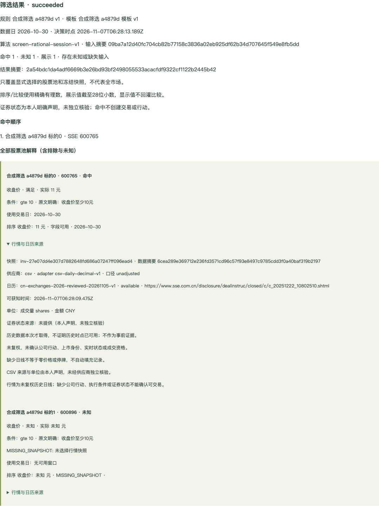

# 版本化规则、筛选模板与来源解释验收（2026-11-07）

本轮筛选切片 **4/4** 通过。原主任务仍为 **21/27**，U0/U5 整项未代签。仅使用本机专库、合成账号/CSV/模型响应；没有读取或迁移真实历史/凭据、请求真实行情/模型、启动旧 Python 服务或发布。机器证据见 [screening.json](screening.json)，子任务见 [screening-subtasks.md](../../plans/grow-zook-native-web/screening-subtasks.md)。

## 交付行为

- 独立规则 ID/不可变版本/摘要、17 个受控字段、最多10条件、四配方、all/any 三态、精确主次排序；保留依据原文、本人/明确/默认/建议的映射和解释。明确引文的数字、单位、窗口、包含边界不允许漂移。条件与配方同时存在时为 AND。
- 模板固定规则 id/version/digest、显式1–20标的池、可选账户、标签、启用/停用。规则改版不重写模板；归档/恢复产生同 ID 新版本，历史不覆盖。没有资产账户也可筛选。
- 创建任务显式选择每个快照及摘要，或双 null 声明缺失；冻结规则/模板/标的、完整行情、交易日历、未复权口径、可获知/决策时点、可选本人声明证券状态。未知和失败不补零、不自动切换来源。
- 接入现有 LightTick worker、owner 事务入口与持久回执。计算在事务外，30秒期限/60秒租约/最多三次执行；取消/撤权/停用/归档/标的改变均阻止迟到发布。单 owner 活动1、UTC日20、保留100，输入2MiB。没有任意代码、交易/行动自动创建或 AI 自动转正式规则。
- 报告覆盖命中/排除/未知的全部股票池、逐条件实际值/阈值/结果/单位/交易日窗口、排序依据及来源/适配器/日历/摘要/局限。BigInt 有理数精确比较，展示截取28位小数不用于计算；盘中未结束、缺日历/交易日记录、零分母、换手率未知均有明确原因。
- React 结构化编辑、精确历史版本核对、股票池/快照选择、任务与来源解释、三方 CAS、原请求恢复、分页回看和离线/切号恢复；云端列表重建保留本机草稿和原 key/body。导出完整冻结数据/定义/版本/创建及取消回执，无密钥、租约/fence；共用 owner 删除覆盖三张新表。

## 验证结果

| 验证 | 结果与关键覆盖 |
| --- | --- |
| OpenAPI | generate/check/lint 通过，6条警告；非 LightTick 221个 schema 与后台文档摘要基线未变 |
| 后端全量 | 2507通过、0失败、1项既有 PostgreSQL invitation 排序跳过 |
| 筛选专项 | 42通过，23组旧字段/三态样本＋8组配方样本，精度/主次排序/盘中未知，原回执/CAS/取消/撤权/导出/HTTP合同 |
| 真实 PostgreSQL/Redis 联合 | 21通过，含两次迁移、并发 CAS、回执失败回滚、owner 晚提交阻塞、租约过期恢复、取消后迟到结果拒绝及清理 |
| 风险专项 | 155通过，8份摘要样本、516条账本；全部516仍未签署完整旧行为等价 |
| Grow | 类型检查、33测试、干净固定源码静态构建通过 |
| Chrome 本轮 | 筛选完整流程＋切号专项通过；规则及执行丢响应后同 key/body、三方冲突、旧版固定、CSV实际worker、运行中取消、停用/归档/恢复、分页过期409重建、离线草稿与320/375/768/1024宽度 |
| Chrome 联合 | 旧13组全部通过：U2、学习、记录、计划、共享行动、实践、回看、正式课程、账户、账本、行情、行情管理、研究；另重跑研究AI/导读/报告与独立资料主流程通过 |
| 重启与产物 | 同一合成数据库重启后旧终态/修订/结果摘要一致；17份服务中静态资源与 manifest SHA 一致，数据库 migration100校验一致 |

本轮实际修复：PG worker 更新 SQL 的闲置参数导致真实执行失败；模板编辑器与执行面板共用 React key 导致旧 DOM 残留；配方涨幅/回撤单位误标。相应 PG、Chrome 唯一编辑器断言和单位断言已保留。早期浏览器驱动的标签空格、重复未知解释定位、重载后未打开规则及 status/alert 定位已按实际 UI 修正，未绕过失败断言。

合成联合 fixture 日志出现 pg 并发 query 弃用提示；本轮最终联合未出现挂起。前一切片锁等待的根因、pg@9兼容和其他 App 开关双态混合 P95 仍由 U0/完整联合门禁审计，不据此宣称风险项已关闭。

## 固定候选与本机入口

- 后端实现 `da06e94a141f6d198168c973b6e0a3b7b6756055`；单位修复运行候选 `f32644888c3e2000e1679fe235c2c93340564fa8`，测试/设计候选 `8310fbbbe78d51d8cea2d6e7d46ab6655a308245`。后两者未改 OpenAPI，前端合同仍固定 da06e94a。
- Grow 实现 `ca7e1ef17fb07b6c40d81f9a4566132e0998f7b7`；最终组件身份修复/干净产物 `1a687f5da14454e0119960c1f21d357674f92ef8`。
- 数据库迁移 `100_lighttick_screening.sql`，业务专库 `grow_web_u1_20261107b1`；联合测试专库 b2，与运行中验收库隔离。前端原暂存区 patch 比较逐字节相同，plan 原生 gitlinks 未修改。
- [投资资料与筛选入口](http://127.0.0.1:58631/grow/investments)。仅本机合成身份 `course9@example.com` / `Password1234`，可打开已有规则/模板与执行历史。验收模板故意停用，恢复仍保留其停用状态；需明确启用和采用当前修订后才能新执行。环境保留运行，不等同 dev/online 发布。合成 fixture 设置计算延迟2秒用于实际取消；生产计算无此延迟。



[320像素界面](screening/rule-320.png) · [切号原请求恢复](screening/owner-recovery.png)

## 可执行复验

在 Zook 根目录运行；必须保留本机专库/Redis，禁止替换为真实数据库。PG脚本会拒绝当前有 HTTP fixture 的数据库。

```sh
npm run check:api-contracts
npm run lint:api-contracts
node apps/admin-web/node_modules/typescript/bin/tsc -p tsconfig.lighttick-screening.json
npm test
LIGHTTICK_TEST_DATABASE_URL=postgresql://grow_web_qa@127.0.0.1:58630/grow_web_u1_20261107b2 GROW_WEB_MODEL_TEST_REDIS_URL=redis://127.0.0.1:58632 node --experimental-transform-types scripts/verify-grow-risk-baseline.ts --postgres
node --experimental-transform-types scripts/verify-grow-risk-baseline.ts --unit
python3 test/support/grow_web_screening_acceptance.py --url http://127.0.0.1:58631 --output .artifacts/screening-recheck --expected-grow-revision 1a687f5da14454e0119960c1f21d357674f92ef8
python3 test/support/grow_web_screening_scope_acceptance.py --url http://127.0.0.1:58631 --output .artifacts/screening-owner-recheck --expected-grow-revision 1a687f5da14454e0119960c1f21d357674f92ef8
```

浏览器每轮会创建合成数据，仍受日预算/容量限制；耗尽后等待预算周期或建立新的独立合成环境，不清理真实历史、不弱化门禁。Grow 根目录执行 `npm run typecheck && npm test`。产物从固定 SHA 的干净 worktree 构建，主工作区旧未提交修改保留。

## 未关闭范围

本轮只给10条旧筛选相关操作附加部分实现证据，不变更其 unreviewed/acceptance 状态；标的交易规则不等于本轮用户筛选规则。旧 AI 自动解析、全市场/扩展字段与实验行为仍逐项核对。预测/实际反馈/监控、策略比较/有限网格/正式回测、账本纠错补偿、其余设置/AI relay、全领域合成迁移、旧客户端/双端专项及混合性能均继续待执行。真机/读屏、真实模型、长期观察、真实迁移和发布继续保持独立待执行。
